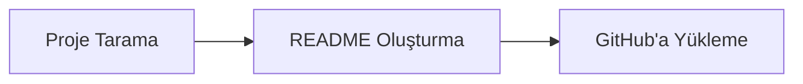

<div align="center">

 

</div>

GitHub Asistan, GitHub projelerini otomatik olarak tarama, profesyonel README oluşturma ve GitHub'a yükleme gibi işlevleri sunan bir uygulamadır. Kullanıcılar, AI destekli README oluşturma ve projeleri yönetme yetenekleri ile daha verimli ve etkili bir şekilde GitHub projelerini yönetebilirler.

<p align="center">
  
</p>

<details>
<summary><b>📋 İçindekiler</b></summary>

- [✨ Özellikler](#-özellikler)
- [⚙️ Nasıl Çalışır](#-nasıl-çalışır)
- [📦 Kurulum](#-kurulum)
- [🚀 Kullanım](#-kullanım)
- [🔧 Yapılandırma](#-yapılandırma)
- [🔌 API Referansı](#-api-referansı)
- [📁 Proje Yapısı](#-proje-yapısı)
- [🤝 Katkıda Bulunma](#-katkıda-bulunma)
- [📄 Lisans](#-lisans)
- [👤 Geliştirici](#-geliştirici)

</details>

## ✨ Özellikler

### 📚 Proje Tarama ve Yönetimi

- Belirttiğiniz klasördeki projeleri otomatik olarak tarama
- GitHub projelerini listeleme, gizleme ve gösterme
- Klasör isimlerini güncelleme
- Proje statisyonunun alındığı projeleri sychronize etme

### 📝 README Oluşturma ve Düzenleme

- AI ile profesyonel README oluşturma
- Ollama ile AI destekli README üretme
- README dosyalarını otomatik olarak oluşturma, yazma ve GitHub'a push etme
- Sosyal medya rozetleri ve teknoloji ikonları ekleme

### 🌐 GitHub Entegrasyonu

- GitHub projelerini doğrudan GitHub'a yükleme
- GitHub token ile projeleri GitHub'a yüklemeye izin verme
- `.gitignore` dikkate alınarak verilerin cihazdaki kalma garantisi sağlama

### 🔧 Ayarlar ve Önbellek Yönetimi

- Kullanıcı ayarlarını ve çalışma alanlarını yönetme
- Tokenleri silme ve düzenlemeye izin verme
- GitHub projelerinin önbelleğini kontrol etme ve güncellemeye çalışma


## ⚙️ Nasıl Çalışır



1. **Proje Tarama** — Belirttiğiniz klasördeki projeleri otomatik olarak tarama ve projeleri listeleme
2. **README Oluşturma** — AI ile profesyonel README oluşturma ve GitHub'a push etme
3. **GitHub'a Yükleme** — GitHub projelerini doğrudan GitHub'a yükleme ve `.gitignore` dikkate alınarak verilerin cihazdaki kalma garantisi sağlama

| Bileşen | Görev |
| --- | --- |
| `lib` | Projeyi klasör yapısını analiz etme, GitHub projelerini analiz etme ve README dosyalarını oluşturma yeteneklerini sağlar |
| `components` | README dosyalarını oluşturmak, düzenlemek ve GitHub'a yükleme için gerekli araçları sağlar |
| `app` | GitHub projelerini yönetme ve README dosyalarını oluşturmayı içerir |
| `DATABASE_URL` | Veritabanı bağlantısını yapılandırır |
| `CSS Yapılandırma` | PostCSS konfigürasyonunu belirler |
| `Prisma Yapılandırma` | Prisma veritabanı ORM'sini ayarlar |

## 📦 Kurulum

**Gereksinimler:** Node.js 18+

```bash
# Repoyu klonlayın
git clone https://github.com/Burakcnz/github-asistan.git
cd github-asistan

# Bağımlılıkları yükleyin
npm install

# Veritabanını hazırlayın
npx prisma db push

# Ortam değişkenlerini ayarlayın
cp .env.example .env
```

## 🚀 Kullanım

```bash
npm run dev
```

Uygulama varsayılan olarak <http://localhost:3000> adresinde açılır. Windows'ta `panel.bat` dosyasına çift tıklayarak da başlatabilirsiniz.

#### GitHub projelerini yönetme

1. Klasör isimlerini güncelleme
2. GitHub projelerini listeleme
3. Gizli projeleri gizleme
4. GitHub projelerini gösterme

#### README dosyalarını oluşturma ve GitHub'a yükleme

1. AI ile README oluşturma
2. README dosyalarını otomatik olarak oluşturma ve GitHub'a push etme
3. Sosyal medya rozetleri ve teknoloji ikonları ekleme
4. GitHub'a yükleme

## 🔧 Yapılandırma

Ayarlar ortam değişkenleriyle yapılır (`.env` dosyası veya sistem ortamı):

| Değişken | Varsayılan | Açıklama |
| --- | --- | --- |
| `DATABASE_URL` | `file:./dev.db` | SQLite veritabanı (proje köküne göre) |
| `OLLAMA_BASE_URL` | `http://127.0.0.1:11434` | Ollama sunucusu |
| `DEFAULT_USER_ID` | `default-user` | Varsayılan kullanıcı kimliğini yapılandırır. |
| `ProgramFiles` | — | Ollama hizmeti için program dosyaları yolu yapılandırır. |

## 🔌 API Referansı

Toplam **21** uç nokta.

<details>
<summary><b>app</b> (21)</summary>

| Yöntem | Yol | Açıklama |
| --- | --- | --- |
| `GET` | `/api/github/validate` |  |
| `POST` | `/api/ollama/download` |  |
| `POST` | `/api/ollama/start` |  |
| `GET` | `/api/ollama/status` |  |
| `POST` | `/api/projects/:id/github` | GitHub ile ilişkili projeleri yönetme |
| `PATCH` | `/api/projects/:id/hide` |  |
| `GET` | `/api/projects/:id/readme/blocks` |  |
| `PUT` | `/api/projects/:id/readme/blocks` |  |
| `POST` | `/api/projects/:id/readme/generate` | README dosyalarını otomatik olarak oluşturma |
| `GET` | `/api/projects/:id/readme/generate` |  |
| `POST` | `/api/projects/:id/readme/write` | README dosyalarını yazma |
| `GET` | `/api/projects/:id/repo-name` |  |
| `PUT` | `/api/projects/:id/repo-name` |  |
| `GET` | `/api/projects/:id` | Proje detaylarını ve önbellek bilgilerini alme |
| `PATCH` | `/api/projects/:id/show` | Proje gösterme |
| `GET` | `/api/projects` | GitHub projelerini listeleme ve statisyonunun alındığı projeleri sychronize etme |
| `GET` | `/api/settings` | Kullanıcı ayarlarını ve tokenleri alme |
| `PUT` | `/api/settings` | Kullanıcı ayarlarını ve tokenleri güncelleme |
| `DELETE` | `/api/settings` | Kullanıcı tokenlerini silme |
| `GET` | `/api/workspace` |  |
| `PUT` | `/api/workspace` |  |

</details>

## 📁 Proje Yapısı

```text
├── app/         # Bu bölüm, GitHub ile ilişkili projeleri yönetme ve README dosyaları…
│   ├── api/
│   ├── hidden/
│   ├── projects/
│   ├── settings/
│   ├── favicon.ico
│   ├── globals.css
│   ├── layout.tsx
│   └── page.tsx
├── components/  # Bu bölüm, GitHub projelerinde README dosyasını oluşturmak, düzenlem…
│   ├── features/
│   ├── layout/
│   └── ui/
├── lib/         # Bu bölüm, projenin klasör yapısını ve GitHub projelerini analiz etm…
│   ├── readme/
│   ├── utils/
│   ├── db.ts
│   ├── env.ts
│   ├── folder-scanner.ts
│   ├── github.ts
│   ├── ollama.ts
│   ├── project-files.ts
│   ├── readme-blocks.ts
│   ├── readme-renderer.ts
│   ├── readme-templates.ts
│   ├── readme-urls.ts
│   ├── repo-name.ts
│   ├── shared.ts
│   └── …
├── prisma/
│   └── schema.prisma
├── public/
│   ├── file.svg
│   ├── globe.svg
│   ├── next.svg
│   ├── vercel.svg
│   └── window.svg
├── AGENTS.md
├── CLAUDE.md
├── dev.db
├── LICENSE
├── next-env.d.ts
├── next.config.ts
├── opencode.json
├── package-lock.json
├── package.json
└── …
```

## 🤝 Katkıda Bulunma

Katkılarınızı bekliyoruz! Şu adımları izleyin:

1. Repoyu fork'layın
2. Yeni bir dal oluşturun (`git checkout -b ozellik/yeni-ozellik`)
3. Değişikliklerinizi commit'leyin (`git commit -m 'Yeni özellik ekle'`)
4. Dalınızı push'layın (`git push origin ozellik/yeni-ozellik`)
5. Bir Pull Request açın

## 📄 Lisans

Bu proje **MIT** lisansı ile lisanslanmıştır. Ayrıntılar için [LICENSE](LICENSE) dosyasına bakın.

## 👤 Geliştirici

<p align="center">
  <a href="https://github.com/Burakcnz"></a>
  <br />
  <b>Burak Can Zengin</b> · <a href="https://github.com/Burakcnz">@Burakcnz</a>
</p>

<p align="center"><a href="https://github.com/Burakcnz/github-asistan">⭐ Projeyi beğendiyseniz yıldız vermeyi unutmayın!</a></p>


